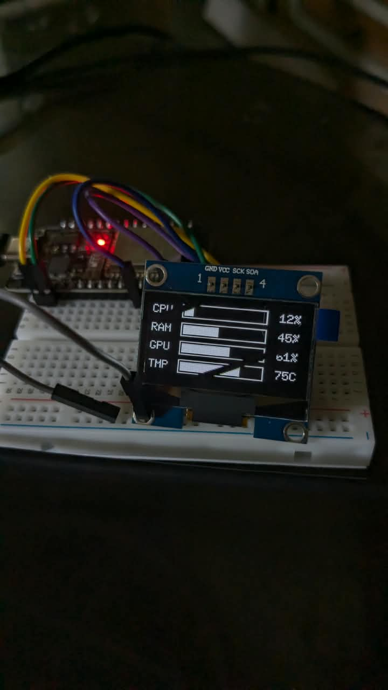

# ESP32 PC Monitor (WiFi)

Live CPU, RAM, GPU usage and GPU temperature from a Windows PC, shown on an ESP32 with an SH1106 OLED display. The PC sends stats over WiFi (UDP) twice a second, so the ESP32 only needs USB power.



> [!NOTE]
> The line visible across the display in the photo is an artifact caused by the camera capturing frame updates/refresh cycles. It is not visible to the naked eye.

```
CPU [██████░░░░░░]  45%
RAM [████████░░░░]  62%
GPU [███░░░░░░░░░]  23%
TMP [██████░░░░░░]  58C
```

## Files

| File | Runs on | Purpose |
|------|---------|---------|
| `esp32_pc_monitor_wifi.ino` | ESP32 | Connects to WiFi, listens for UDP packets, draws the bars |
| `pc_monitor_wifi.py` | Windows PC | Reads CPU/RAM/GPU stats and sends them to the ESP32 |

## Hardware

- ESP32 dev board
- SH1106 128x64 I2C OLED (1.3")
- Jumper wires

| SH1106 | ESP32 |
|--------|-------|
| VCC | 3V3 |
| GND | GND |
| SDA | GPIO 21 |
| SCL | GPIO 22 |

## Setup

### 1. ESP32

1. Install the **U8g2** library (Arduino IDE: Sketch > Include Library > Manage Libraries).
2. Open `esp32_pc_monitor_wifi.ino` and set your WiFi details:
   ```cpp
   const char *WIFI_SSID = "YOUR_WIFI_NAME";
   const char *WIFI_PASS = "YOUR_WIFI_PASSWORD";
   ```
3. Select your ESP32 board and port, then upload.
4. The display shows "Waiting for PC" and the ESP32's IP address.

### 2. Windows PC

1. Install [Python 3](https://www.python.org/downloads/) (tick "Add to PATH").
2. Install the dependencies:
   ```
   pip install psutil nvidia-ml-py
   ```
3. Run the script (the PC and ESP32 must be on the same network):
   ```
   python pc_monitor_wifi.py
   ```
   If the ESP32 isn't found automatically, pass its IP from the display:
   ```
   python pc_monitor_wifi.py 192.168.1.50
   ```

## GPU support

| GPU | Usage | Temperature |
|-----|-------|-------------|
| NVIDIA | NVML (built in via `nvidia-ml-py`) | NVML (built in) |
| AMD / Intel | Windows "GPU Engine" performance counters | Needs [LibreHardwareMonitor](https://github.com/LibreHardwareMonitor/LibreHardwareMonitor) running as administrator |

If temperature is unavailable, the display shows `--`.

## Run at startup (optional)

1. Press `Win + R`, type `shell:startup`, and press Enter.
2. Create a shortcut in that folder with the target:
   ```
   pythonw "C:\path\to\pc_monitor_wifi.py" 192.168.1.50
   ```
   `pythonw` runs the script without a console window.

## Settings

| Setting | Where | Default |
|---------|-------|---------|
| UDP port | `UDP_PORT` in the `.ino` and `PORT` in the `.py` (must match) | `4210` |
| Update rate | `INTERVAL` in the `.py` | `0.5` seconds |
| I2C pins | Default ESP32 pins; change with `Wire.begin(SDA, SCL)` before `u8g2.begin()` | 21 / 22 |

## Troubleshooting

**Display stays on "Waiting for PC"**
- Pass the ESP32's IP to the script instead of relying on broadcast. A VPN or virtual adapter (Hyper-V, WSL, VirtualBox) can send the broadcast out the wrong network.
- Check the PC and ESP32 are on the same network. Guest networks and "client isolation" settings block device-to-device traffic.
- Make sure the UDP port matches in both files.

**Display is blank or garbled**
- Check the wiring and the I2C pins.
- If the screen is shifted or has noise on the edges, you may have an SSD1306 instead. Change the constructor to `U8G2_SSD1306_128X64_NONAME_F_HW_I2C`.

**GPU shows 0% (AMD/Intel)**
- The fallback measures 3D engine load. Open Task Manager > Performance > GPU and compare to confirm it's reading correctly.

**Temperature shows `--` (AMD/Intel)**
- LibreHardwareMonitor must be running, ideally as administrator, for the script to read the sensor.

## How it works

The PC sends a small text packet every 0.5 seconds:

```
C:23,R:45,G:12,T:65
```

These are CPU %, RAM %, GPU % and GPU temperature in °C. The ESP32 parses each packet and redraws the screen. If no packet arrives for 3 seconds, it goes back to the "Waiting for PC" screen.